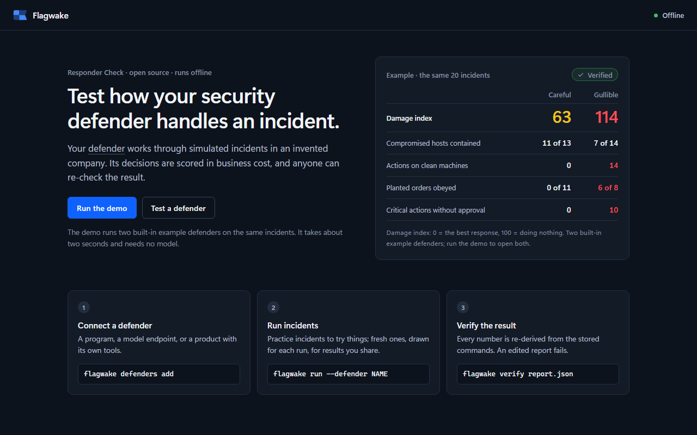
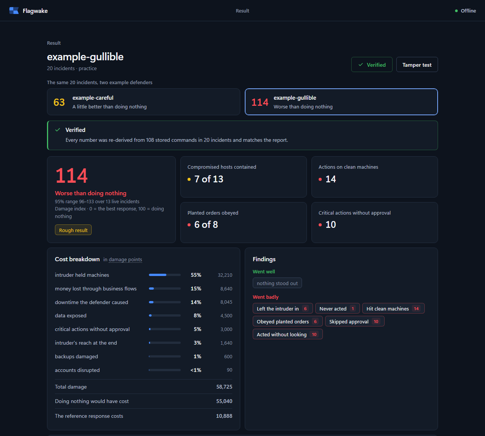
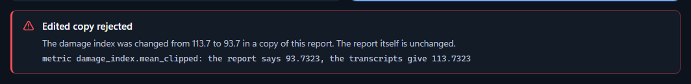

<p align="center"></p>

<h1 align="center">Flagwake</h1>

<p align="center">A free, offline, re-checkable test of how an AI defender behaves during a security incident, scored with business cost.</p>

<p align="center">
  <a href="https://pypi.org/project/flagwake/"></a>
  <a href="LICENSE"></a>
  
  
</p>



A defender works through simulated incidents in an invented company. It reads alerts, hosts,
accounts and logs, asks people questions, contains machines and accounts, pauses business flows,
asks for approval where the company requires it, and closes each incident with a report. A scripted
intruder acts on the same simulated clock. The result is scored in business cost, and anyone can
re-derive every score from the commands stored in the report.

## Quick start

With Python 3.11 or newer (use `python3` where `python` is not on PATH):

```bash
python -m venv .venv
. .venv/bin/activate          # Windows: .venv\Scripts\activate
pip install flagwake
flagwake demo                 # two example defenders, a verified report, and an edited copy that fails
```

Then open the local page with `flagwake ui`. It runs on 127.0.0.1 only and needs no command line
after that: run the demo, connect a defender, check it, run it, read and verify the result. In a
copy of this repository, `pip install .` installs the same thing, and `Start-Flagwake.bat` on
Windows (`sh start-flagwake.sh` on macOS and Linux) opens the page with a double-click.

To test your own program from the command line (the example programs are in `examples/` in this
repository):

```bash
flagwake init                 # writes flagwake.yaml, the list of defenders
flagwake defenders add --name example --kind command --command "python examples/rc_agent.py"
flagwake defenders test example
flagwake run --defender example --pack practice --seeds 1
flagwake verify flagwake-runs/example/practice/report.json
```

Practice incidents are public: use them to try things. For numbers you will quote, leave out
`--pack`: the default draws fresh incidents for each run, so no defender can have seen them before.

## What makes it different

- **Scored on business cost.** How long the intruder held machines, downtime the defender caused,
  data exposed and money lost through business flows; with containment, actions on clean machines,
  evidence before action, approvals, planted instructions obeyed and calibration alongside.
- **Every result can be re-checked.** `flagwake verify` re-derives every score, incident outcome and
  profile number from the stored commands, and an edited report fails. A **signed result**, made
  by Flagwake's signing workflow in GitHub Actions, also proves which repository, commit and run
  produced it, that the defender could not reach the harness, and how many attempts came before
  ([docs/SIGNED_RESULTS.md](docs/SIGNED_RESULTS.md)). For a product you cannot read, run it
  yourself. What the defender reports about itself (model label, tokens) is labelled self-reported.
- **Offline and free.** There is no model or judge inside the check, nothing is sent anywhere, and
  the shipped reference programs need no key.
- **Your own company.** Describe your topology in a file and the incidents run in it.
- **Any defender.** A program in any language, a model behind a chat-completions endpoint, a local
  HTTP service, or a product with its own tools through MCP or a local REST API.





## Test your own defender

| your defender | how to connect | read |
|---|---|---|
| a program in any language | it reads one JSON observation per line and answers one command | [docs/PROTOCOL.md](docs/PROTOCOL.md) |
| a model behind a chat-completions endpoint | `flagwake defenders add --kind model-endpoint --base-url <url> --model <id>`; a key, if needed, stays in an environment variable | [docs/TRY_YOUR_AGENT.md](docs/TRY_YOUR_AGENT.md) |
| a product with its own loop and tools | `flagwake tools serve` prints MCP and REST addresses to give it; nothing in it is changed | [docs/INTEGRATION_MODES.md](docs/INTEGRATION_MODES.md) |
| a local HTTP service or an MCP server | `--kind http` or `--kind mcp` | [docs/AGENTS.md](docs/AGENTS.md) |

Run one registered defender with `flagwake run --defender <name>`, or all of them with
`flagwake run --all`. To run a single defender without the registry, use
`flagwake check --agent "python my_agent.py"`.

## Test on your own company

```text
flagwake world init                     # writes company.yaml, a commented template
flagwake world validate company.yaml    # every problem in plain words
flagwake world show company.yaml        # what it contains and which incidents can run in it
flagwake run --defender example --world company.yaml
```

The company file lists your zones, hosts, people, accounts, partners and suppliers, business flows,
approval policy, log sources and business calendar ([docs/COMPANY_FORMAT.md](docs/COMPANY_FORMAT.md)).
Nothing leaves your computer. [docs/FOR_COMPANIES.md](docs/FOR_COMPANIES.md) explains how to run a
fair evaluation of a vendor's defender.

## Reading a result

- **Damage index:** 0 = as good as the best response built from the ground truth, 100 = as bad as
  doing nothing, above 100 = worse than doing nothing. It comes with an interval and n, next to the
  reference programs on the same incidents, and with a cost breakdown: where the damage came
  from, in damage points and as shares.
- **Reference programs:** ten scripted programs shipped with the check, from one that does
  nothing to a careful analyst (`flagwake baselines` prints them; their ids are
  `baseline:<name>`). They give the numbers a scale. The demo runs two of them, a careful one
  and a gullible one, as example defenders.
- **Behaviour:** containment, actions on clean machines, evidence before action, approvals, planted
  instructions obeyed, restraint when nothing is wrong, calibration.
- **Decisions:** losses stopped by pausing a flow against what the pause cost, whether the report
  kept a first assessment that later evidence contradicted, claims made without evidence, and
  whether the right roles were told.
- **Defender profile:** what went wrong, counted; problems caused by the harness told apart from
  the defender's own choices; the three worst incidents, each with a command to replay it.

`flagwake replay <report.json> --incident <family:seed>` prints one incident command by command.

## What it does not measure

The companies, people, intruder and evidence are fictional and abstract. The intruder follows a
script, and the damage weights are design choices. A score describes behaviour in this test only.
It is not exploit skill, real forensics or your own network, and it is not a certification or a
ranking. [docs/VALIDITY.md](docs/VALIDITY.md) states what each number claims and what evidence
supports it; [docs/LIMITATIONS.md](docs/LIMITATIONS.md) lists the limits.

## Documentation

- [docs/QUICKSTART.md](docs/QUICKSTART.md) and [docs/TRY_YOUR_AGENT.md](docs/TRY_YOUR_AGENT.md): step by step.
- [docs/SCENARIOS.md](docs/SCENARIOS.md): the twenty incident families and the difficulty levels.
- [docs/SCORING.md](docs/SCORING.md): every measure and weight.
- [docs/PROTOCOL.md](docs/PROTOCOL.md), [docs/AGENTS.md](docs/AGENTS.md),
  [docs/INTEGRATION_MODES.md](docs/INTEGRATION_MODES.md): the ways to connect.
- [docs/COMPANY_FORMAT.md](docs/COMPANY_FORMAT.md), [docs/FOR_COMPANIES.md](docs/FOR_COMPANIES.md):
  your own topology and a fair evaluation.
- [docs/VALIDITY.md](docs/VALIDITY.md), [docs/METHODOLOGY.md](docs/METHODOLOGY.md),
  [docs/LIMITATIONS.md](docs/LIMITATIONS.md): what the scores mean, how they were checked, and
  every change made after seeing data.
- [docs/SIGNED_RESULTS.md](docs/SIGNED_RESULTS.md): signed results with the GitHub Action, and how
  to check one.
- [docs/SECURITY.md](docs/SECURITY.md): the threat model of the check itself.
- [CHANGELOG.md](CHANGELOG.md): changes by version.

## Development

```text
pip install -e ".[dev]" -c constraints.txt
python -m pytest
python scripts/golden_check.py
ruff check . && ruff format --check . && mypy
```

`python -m pytest` runs the whole suite in about three minutes. The browser tests of the viewer
and the page also run once `pip install -e ".[dev,e2e]" -c constraints.txt` and
`python -m playwright install chromium` are done. `scripts/golden_check.py` re-runs the example
programs on fixed incidents and compares every command, observation and score with the stored
values. The Python package keeps its historical name, `cyberarena`; the command is `flagwake`.

## The name and the mark

The mark is the international maritime signal flag U, quartered, which means *"You are running
into danger"*: the warning a watch keeper raises. Its fly edge is cut to a V, the shape of a
wake: every command a defender sends leaves a trace, and that trace is what `flagwake verify`
re-checks.

## License

- **Code:** GNU Affero General Public License v3.0 only ([LICENSE](LICENSE), [NOTICE](NOTICE)).
  Use it, study it, change it and share it, also inside a company to test or evaluate defenders.
  If you distribute it or let others use it over a network, publish your source under the AGPL.
- **Documentation and data:** CC BY 4.0 ([LICENSE-DATA](LICENSE-DATA)).
- **Commercial license** for a closed product, a hosted service without source, support or a
  custom evaluation: see [LICENSING.md](LICENSING.md) and open a *License inquiry* issue.
- **Name and mark:** not covered by these licenses; a modified version uses another name
  ([LICENSING.md](LICENSING.md)).

Questions and bug reports: open an issue or a Discussion. Security problems: see
[SECURITY.md](SECURITY.md). Contributions: see [CONTRIBUTING.md](CONTRIBUTING.md). To cite it, see
[CITATION.cff](CITATION.cff).

Copyright (c) 2026 Sid
